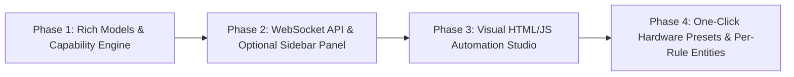

# v0.3.0 Roadmap: On-Device Automations & Visual Sidebar Studio

## 1. Overview & Motivation

Eltako Series 62-IP and Series 64-IPM actuators include an embedded, fail-safe hardware automation engine (**ELTAKO Basic Automations**) exposed via the local REST endpoint `/services/eltako/automations`.

Unlike Home Assistant software automations—which require the Wi-Fi network, Home Assistant server, and polling loop to be online—**on-device automations execute directly inside the Eltako microcontroller**:
- **Zero-latency hardware execution**: Physical wired inputs (`input`, `inputChannel1`, `inputChannel2`) and paired EnOcean sensors (`FT55` rockers, `FTK` window contacts, motion/climate sensors) trigger the local relay (`ESR`), dimmer (`EUD`), or shading actuator (`ESB`) instantaneously.
- **Fail-safe operation**: Wall switches, staircase timers, window-open lockouts, and dimmer curves continue to work even if Wi-Fi or Home Assistant is down.

### Why an Optional Sidebar Dashboard Instead of Config Flow Forms?
Home Assistant's multi-step Options Flow modals are great for simple settings, but poorly suited for managing a matrix of hardware automation rules across multiple gateways, input channels, timer addons, and dimmer extensions.

Home Assistant allows custom integrations to register:
1. **Static Frontend Assets** (`hass.http.async_register_static_paths`) served directly from `custom_components/eltako_ip/frontend/`.
2. **An Optional Custom Sidebar Panel** (`panel_custom.async_register_panel` / `frontend.async_remove_panel`) that can be toggled on or off in the integration options (or via a gateway config switch).
3. **Dedicated WebSocket API Commands** (`@websocket_api.websocket_command`) that give the frontend panel real-time access to all configured Eltako gateways, their paired EnOcean devices, product capability schemas, and live `/services/eltako/automations` rules.

Because the panel is mounted as a native Home Assistant Custom Element (`<eltako-automations-panel>`), it receives Home Assistant's live `hass` object directly—inheriting user authentication (`hass.callWS(...)`), active dark/light theme CSS variables (`--card-background-color`, `--primary-color`), and localization without needing external dependencies or an iframe login.

---

## 2. Current Baseline (`v0.2.1`)

The integration already provides the foundational building blocks for on-device automations:

1. **Async Client (`src/aioeltako_ip`)**:
   - [`AutomationRule`](src/aioeltako_ip/models.py) and [`AutomationAddOn`](src/aioeltako_ip/models.py) dataclasses modeling `/services/eltako/automations`.
   - Full CRUD methods on [`EltakoClient`](src/aioeltako_ip/client.py):
     - `get_automations()` (`GET /services/eltako/automations`)
     - `get_automation(guid)` (`GET /services/eltako/automations/{automationGuid}`)
     - `create_automation(rule)` (`POST /services/eltako/automations`)
     - `update_automation(rule)` / `set_automation_logic(...)` (`PUT /services/eltako/automations/{automationGuid}`)
     - `delete_automation(guid)` (`DELETE /services/eltako/automations/{automationGuid}`)
     - `reset_automations()` (`DELETE /services/eltako/automations`)
2. **Home Assistant Entities & Services (`custom_components/eltako_ip`)**:
   - **Gateway Diagnostic Sensor**: [`EltakoAutomationsCountSensor`](custom_components/eltako_ip/sensor.py) reporting the count and summary list of active rules.
   - **Default Wired Input Controls**:
     - [`EltakoWiredInputModeSelect`](custom_components/eltako_ip/select.py) (`buttonImpulseSwitch`, `buttonSwitch`, `buttonNormallyOpened`, `buttonNormallyClosed`).
     - [`EltakoAutomationOffTimerNumber`](custom_components/eltako_ip/number.py) (`offTimer` addon in seconds).
   - **Domain Services**: `eltako_ip.create_automation`, `eltako_ip.update_automation`, `eltako_ip.delete_automation`, and `eltako_ip.reset_automations`.

---

## 3. Hardware Automation Capabilities (OpenAPI 3.1 Spec)

The Eltako firmware groups on-device automations into three families depending on the output actuator class:

### A. Relay & Shading Actuators (`ESR62/64` & `ESB62/64`)
- **Core Logics (`configuration.logic`)**:
  - `buttonImpulseSwitch`: Toggle output on button impulse (pushbutton / *Taster*).
  - `buttonSwitch`: Toggle output on press or release (rocker switch / *Kippschalter*).
  - `buttonNormallyOpened`: Momentary NO contact (closes on impulse, reopens on release).
  - `buttonNormallyClosed`: Momentary NC contact (opens on impulse, recloses on release).
  - `target`: Move output to a specific `targetValue` addon (or toggle min/max if omitted).
- **AddOns (`configuration.addOns`)**:
  | AddOn Type | Target Models | Parameters | Description |
  | :--- | :--- | :--- | :--- |
  | `targetValue` | `ESR62/64`, `ESB62/64` | `data` (`int`) | Desired target state or blind position (`0–100`) |
  | `offTimer` | `ESR62/64` | `time` (`ms`) | Auto-off staircase timer after short press |
  | `longPressOffTimer` | `ESR62/64` | `time` (`ms`) | Auto-off timer triggered by a long press |
  | `prewarning` | `ESR62/64` | — | Flickers relay 3× starting 30s before `offTimer` expires |
  | `shortPressNormallyOpened` | `ESB62/64` | — | Group switch (`GS4`) mode with `targetValue` |
  | `extraLongPressNormallyOpened` | `ESB64` | — | Store last tilt angle as new `automaticSlat` angle |
  | `automaticReversal` | `ESB64` | `data` (`angle`) | Tilt slats back to angle when lower end position is reached |
  | `automaticSlat` | `ESB64` | `data` (`angle`) | Tilt slats back to angle when blind motion stops |
  | `sceneButton` | `ESB64` | — | Marks input as a shading scene button |
  | `sceneValueOverride` | `ESB64` | — | Hold 3–10s to save current position as scene target |
  | `sceneWithReferenceMovement` | `ESB64` | — | Homing reference move to top before moving to `targetValue` |
  | `targetAngle` | `ESB64` | `data` (`angle`) | Tilt slats to angle after reaching `targetValue` |

### B. Universal Dimmers (`EUD62/64`)
- **Dimmer Logics (`configuration.logic`)**:
  - `universalButtonDimmer`: Single-button short press on/off (`lastBrightness`), long press dim up/down, double-click slumber.
  - `directionalUpButtonDimmer`: Dedicated "Up / On" rocker half (`turnOnDuration`, `dimDuration`).
  - `directionalDownButtonDimmer`: Dedicated "Down / Off" rocker half (`turnOffDuration`, `dimDuration`).
  - `centralUpButtonDimmer` / `centralDownButtonDimmer`: Central on (`maximumBrightness`) or central off.
  - `sceneButtonDimmer`: Recall brightness scene on short press, save current brightness on 3–10s hold.
- **Dimmer `logicConfiguration` & Extensions**:
  - Timing parameters (`ms`): `turnOnDuration`, `turnOffDuration`, `dimDuration`, `targetBrightness`.
  - `childrenRoomExtension`: `{enabled, dimDuration, targetBrightness}` (soft dim-on from off state on long press).
  - `slumberExtension`: `{enabled, dimDuration}` (gradual fade-to-zero on double-click).
  - `lightAlarmExtension`: `{enabled, dimDuration}` (sunrise fade to `maximumBrightness` on double-click).
  - `sceneValueOverrideExtension`: `{enabled}` (save scene brightness on 3–10s hold).

### C. Sensor-to-Actuator & Thermostat Automations
- `thermostatSetReferenceTemperature`: Links an EnOcean temperature sensor (`inputCharacteristicIdentifier: "temperature"`) to a thermostat actuator (`outputCharacteristicIdentifier: "referenceTemperature"`).
- Window contact (`FTK`) to relay/shading lockout or trigger rules.

---

## 4. `v0.3.0` Architecture & Phased Implementation Plan

### Phase 1: Rich Data Models & Capability Engine (`aioeltako-ip`)
- **Goal**: Expand [`AutomationRule`](src/aioeltako_ip/models.py) and [`AutomationAddOn`](src/aioeltako_ip/models.py) to losslessly represent all hardware automation schemas across `ESR`, `EUD`, and `ESB` devices.
- **Deliverables**:
  - Full serialization/deserialization for all 12 `ESR`/`ESB` `addOns` (`prewarning`, `longPressOffTimer`, `targetValue`, `targetAngle`, `automaticSlat`, `automaticReversal`, etc.).
  - Typed dataclasses for `EUD` `logicConfiguration` (`turnOnDuration`, `turnOffDuration`, `dimDuration`, `targetBrightness`) and its 4 comfort extensions (`childrenRoomExtension`, `slumberExtension`, `lightAlarmExtension`, `sceneValueOverrideExtension`).
  - Surface `description`, `operatingStatus`, and `errors` from `/services/eltako/automations` responses.
  - Build a capability matrix helper that inspects `coordinator.data.devices` and `coordinator.data.products` to enumerate valid triggers `(inputDeviceGuid, inputCharacteristicIdentifier)` and targets `(outputDeviceGuid, outputCharacteristicIdentifier)` for each gateway.

### Phase 2: WebSocket API & Optional Sidebar Registration (`custom_components/eltako_ip`)
- **Goal**: Expose a fast, authenticated WebSocket bridge and a toggleable sidebar entry in Home Assistant.
- **Deliverables**:
  - **Optional Sidebar Toggle**:
    - Add a `show_sidebar_panel` toggle (default `True` or configurable in Options Flow / gateway `SwitchEntity`) that dynamically registers or removes the **Eltako Studio** sidebar item using `panel_custom.async_register_panel` and `frontend.async_remove_panel` without requiring a Home Assistant restart.
    - Serve self-contained static frontend bundle from `custom_components/eltako_ip/frontend/eltako-panel.js` via `hass.http.async_register_static_paths`.
  - **WebSocket Commands (`custom_components/eltako_ip/websocket_api.py`)**:
    - `eltako_ip/gateways`: List all configured Eltako IP gateways, their devices, EnOcean sensors, and product capability schemas.
    - `eltako_ip/automations/list`: Return all on-device automations with resolved device names, characteristic labels, and health status.
    - `eltako_ip/automations/save`: Create (`POST`) or update (`PUT`) an on-device automation rule with full `addOns` and `logicConfiguration` payload, followed by an immediate coordinator refresh.
    - `eltako_ip/automations/delete` & `eltako_ip/automations/reset`: Delete a single rule or reset to factory defaults.

### Phase 3: Visual HTML/JS Automation Studio (`custom_components/eltako_ip/frontend/`)
- **Goal**: Build a zero-dependency, native-feeling HTML/CSS/JS Web Component (`<eltako-automations-panel>`) styled with Home Assistant's Material / HaCard design tokens.
- **Deliverables**:
  - **Gateway Selector & Overview Header**:
    - Switch between multiple Eltako IP gateways on the network, displaying hardware model (`ESR64PF-IPM`, `EUD64NPN-IPM`, `ESB64NP-IPM`), active rule count, and factory-reset action.
  - **Visual Rule Cards (`[Trigger] ──► [Logic & Timers] ──► [Target]`)**:
    - Each on-device rule is displayed as an interactive flow card showing:
      - **Input Trigger**: Device icon, friendly name (`ELTAKO-Wired input`, `ELTAKO-FTK`, `FT55`), characteristic (`input`, `contact`, `buttonA0`), and EnOcean RSSI badge.
      - **Logic & AddOn Badges**: Logic mode pill (`Impulse Switch`, `Universal Dimmer`, etc.), active timer pills (`Off-Timer: 10s`, `Prewarning Flicker`), and `operatingStatus` health indicator.
      - **Output Target**: Target actuator and channel (`Relay`, `Brightness 80%`, `Position 100% / Tilt 45°`).
      - Quick actions: Enable/Disable toggle switch, Edit drawer, and Delete button.
  - **Context-Aware Rule Editor Drawer / Modal**:
    - Selecting an output actuator dynamically adapts the form:
      - **Relay (`ESR`)**: Shows `Impulse`, `Switch`, `NO`, `NC`, `Target` logics + `offTimer`, `longPressOffTimer`, and `prewarning` flicker controls.
      - **Dimmer (`EUD`)**: Shows dimmer logics, ramp duration sliders (`turnOnDuration`, `turnOffDuration`, `dimDuration`), and expandable cards for `Children's Room`, `Slumber`, and `Light Alarm` extensions.
      - **Shading (`ESB`)**: Shows blind position/angle sliders (`targetValue`, `targetAngle`, `automaticSlat`, `automaticReversal`, `sceneWithReferenceMovement`).

### Phase 4: One-Click Hardware Presets & Per-Rule Entities
- **Goal**: Make common multi-rule setups effortless and expose individual rule toggles to Home Assistant dashboards/automations.
- **Deliverables**:
  - **One-Click Templates in the Sidebar Studio**:
    - *Staircase Timer with Prewarning*: Configures wired input or EnOcean button with `buttonImpulseSwitch` + `offTimer` + 30s `prewarning` flicker.
    - *2-Button EnOcean Rocker (`FT55`) Binding*: Automatically generates both the Up (`directionalUpButtonDimmer` / blind open) and Down (`directionalDownButtonDimmer` / blind close) rules in one click.
    - *Window Open Lockout / Trigger (`FTK`)*: Binds a paired `FTK` contact sensor to a relay or blind actuator.
  - **Per-Rule Enable/Disable Switch Entities**:
    - Expose an `EltakoAutomationSwitch` (`EntityCategory.CONFIG`) for each rule on its triggering device page so Home Assistant automations can also enable or disable hardware rules dynamically (e.g., disabling a physical wall switch in child-lock mode at night).
