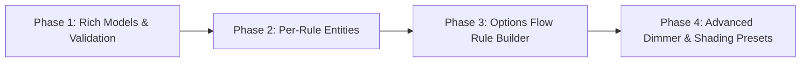

# Roadmap: On-Device Automations (`ELTAKO Basic Automations`)

## 1. Overview & Motivation

Eltako Series 62-IP and Series 64-IPM actuators include an embedded, fail-safe automation engine (**ELTAKO Basic Automations**) exposed via the local REST endpoint `/services/eltako/automations`.

Unlike Home Assistant software automations—which require the Wi-Fi network, Home Assistant server, and polling loop to be online—**on-device automations execute directly inside the Eltako microcontroller**:
- **Zero-latency hardware execution**: Physical wired inputs (`input`, `inputChannel1`, `inputChannel2`) and paired EnOcean sensors (`FT55` rockers, `FTK` window contacts, motion/climate sensors) trigger the local relay (`ESR`), dimmer (`EUD`), or shading actuator (`ESB`) instantaneously.
- **Fail-safe operation**: Wall switches, staircase timers, window-open lockouts, and dimmer curves continue to work even if Wi-Fi or Home Assistant is down.

---

## 2. Current Baseline (v0.2.1)

The integration already provides the foundational building blocks for on-device automations:

1. **Async Client (`src/aioeltako_ip`)**:
   - [`AutomationRule`](src/aioeltako_ip/models.py) and [`AutomationAddOn`](src/aioeltako_ip/models.py) dataclasses modeling `/services/eltako/automations`.
   - Full CRUD methods on [`EltakoClient`](src/aioeltako_ip/client.py):
     - `get_automations()` (`GET /services/eltako/automations`)
     - `get_automation(guid)` (`GET /services/eltako/automations/{automationGuid}`)
     - `create_automation(rule)` (`POST /services/eltako/automations`)
     - `update_automation(rule)` / `set_automation_logic(...)` (`PUT /services/eltako/automations/{automationGuid}`)
     - `delete_automation(guid)` (`DELETE /services/eltako/automations/{automationGuid}`)
     - `reset_automations()` (`DELETE /services/eltako/automations`)
2. **Home Assistant Entities & Services (`custom_components/eltako_ip`)**:
   - **Gateway Diagnostic Sensor**: [`EltakoAutomationsCountSensor`](custom_components/eltako_ip/sensor.py) reporting the count and summary list of active rules.
   - **Default Wired Input Controls**:
     - [`EltakoWiredInputModeSelect`](custom_components/eltako_ip/select.py) (`buttonImpulseSwitch`, `buttonSwitch`, `buttonNormallyOpened`, `buttonNormallyClosed`).
     - [`EltakoAutomationOffTimerNumber`](custom_components/eltako_ip/number.py) (`offTimer` addon in seconds).
   - **Domain Services**: `eltako_ip.create_automation`, `eltako_ip.update_automation`, `eltako_ip.delete_automation`, and `eltako_ip.reset_automations`.

---

## 3. Hardware Automation Capabilities (OpenAPI 3.1 Spec)

The Eltako firmware groups on-device automations into three families depending on the output actuator class:

### A. Relay & Shading Actuators (`ESR62/64` & `ESB62/64`)
- **Core Logics (`configuration.logic`)**:
  - `buttonImpulseSwitch`: Toggle output on button impulse (pushbutton / *Taster*).
  - `buttonSwitch`: Toggle output on press or release (rocker switch / *Kippschalter*).
  - `buttonNormallyOpened`: Momentary NO contact (closes on impulse, reopens on release).
  - `buttonNormallyClosed`: Momentary NC contact (opens on impulse, recloses on release).
  - `target`: Move output to a specific `targetValue` addon (or toggle min/max if omitted).
- **AddOns (`configuration.addOns`)**:
  | AddOn Type | Target Models | Parameters | Description |
  | :--- | :--- | :--- | :--- |
  | `targetValue` | `ESR62/64`, `ESB62/64` | `data` (`int`) | Desired target state or blind position (`0–100`) |
  | `offTimer` | `ESR62/64` | `time` (`ms`) | Auto-off staircase timer after short press |
  | `longPressOffTimer` | `ESR62/64` | `time` (`ms`) | Auto-off timer triggered by a long press |
  | `prewarning` | `ESR62/64` | — | Flickers relay 3× starting 30s before `offTimer` expires |
  | `shortPressNormallyOpened` | `ESB62/64` | — | Group switch (`GS4`) mode with `targetValue` |
  | `extraLongPressNormallyOpened` | `ESB64` | — | Store last tilt angle as new `automaticSlat` angle |
  | `automaticReversal` | `ESB64` | `data` (`angle`) | Tilt slats back to angle when lower end position is reached |
  | `automaticSlat` | `ESB64` | `data` (`angle`) | Tilt slats back to angle when blind motion stops |
  | `sceneButton` | `ESB64` | — | Marks input as a shading scene button |
  | `sceneValueOverride` | `ESB64` | — | Hold 3–10s to save current position as scene target |
  | `sceneWithReferenceMovement` | `ESB64` | — | Homing reference move to top before moving to `targetValue` |
  | `targetAngle` | `ESB64` | `data` (`angle`) | Tilt slats to angle after reaching `targetValue` |

### B. Universal Dimmers (`EUD62/64`)
- **Dimmer Logics (`configuration.logic`)**:
  - `universalButtonDimmer`: Single-button short press on/off (`lastBrightness`), long press dim up/down, double-click slumber.
  - `directionalUpButtonDimmer`: Dedicated "Up / On" rocker half (`turnOnDuration`, `dimDuration`).
  - `directionalDownButtonDimmer`: Dedicated "Down / Off" rocker half (`turnOffDuration`, `dimDuration`).
  - `centralUpButtonDimmer` / `centralDownButtonDimmer`: Central on (`maximumBrightness`) or central off.
  - `sceneButtonDimmer`: Recall brightness scene on short press, save current brightness on 3–10s hold.
- **Dimmer `logicConfiguration` & Extensions**:
  - Timing parameters (`ms`): `turnOnDuration`, `turnOffDuration`, `dimDuration`, `targetBrightness`.
  - `childrenRoomExtension`: `{enabled, dimDuration, targetBrightness}` (soft dim-on from off state on long press).
  - `slumberExtension`: `{enabled, dimDuration}` (gradual fade-to-zero on double-click).
  - `lightAlarmExtension`: `{enabled, dimDuration}` (sunrise fade to `maximumBrightness` on double-click).
  - `sceneValueOverrideExtension`: `{enabled}` (save scene brightness on 3–10s hold).

### C. Sensor-to-Actuator & Thermostat Automations
- `thermostatSetReferenceTemperature`: Links an EnOcean temperature sensor (`inputCharacteristicIdentifier: "temperature"`) to a thermostat actuator (`outputCharacteristicIdentifier: "referenceTemperature"`).
- Window contact (`FTK`) to relay/shading lockout or trigger rules.

---

## 4. Phased Implementation Plan

### Phase 1: Rich Data Models & Characteristic Discovery (`aioeltako-ip`)
- **Goal**: Expand [`AutomationRule`](src/aioeltako_ip/models.py) and [`AutomationAddOn`](src/aioeltako_ip/models.py) to losslessly represent all hardware automation schemas.
- **Deliverables**:
  - Add typed helpers for all 12 `ESR`/`ESB` `addOns` (`prewarning`, `longPressOffTimer`, `targetValue`, `targetAngle`, `automaticSlat`, `automaticReversal`, etc.).
  - Add typed dataclasses for `EUD` `logicConfiguration` (`turnOnDuration`, `turnOffDuration`, `dimDuration`) and its 4 extensions (`childrenRoomExtension`, `slumberExtension`, `lightAlarmExtension`, `sceneValueOverrideExtension`).
  - Surface `operatingStatus` and `errors` from `/services/eltako/automations` responses so misconfigured rules are visible in Home Assistant.
  - Add a capability helper that inspects `coordinator.data.devices` and `coordinator.data.products` to list valid `(inputDeviceGuid, inputCharacteristicIdentifier)` triggers and `(outputDeviceGuid, outputCharacteristicIdentifier)` targets on the gateway.

### Phase 2: Per-Automation Entities in Home Assistant
- **Goal**: Expose existing on-device automations as first-class controllable entities rather than only a summary count sensor.
- **Deliverables**:
  - **Enable/Disable Switch (`switch`)**: Create an `EltakoAutomationSwitch` (`EntityCategory.CONFIG`) for each rule (`automationGuid`) to toggle `enabled: true/false` directly from the UI, attached to the input device (e.g. `ELTAKO-Wired input` or paired EnOcean sensor) so users see which rules a sensor triggers.
  - **Rule Logic & AddOn Entities (`select` / `number` / `switch`)**:
    - Generalize [`EltakoWiredInputModeSelect`](custom_components/eltako_ip/select.py) and [`EltakoAutomationOffTimerNumber`](custom_components/eltako_ip/number.py) so *any* button/sensor automation rule (including EnOcean rockers and `FTK` contacts) exposes its logic mode and timer/target parameters on the triggering device's page.
    - Expose a `Prewarning Flicker` toggle (`switch`) when `offTimer` or `longPressOffTimer` is active on `ESR62/64`.
    - Expose a `Delete Automation` button (`button`) on user-created rules.

### Phase 3: Interactive On-Device Automation Wizard (Options Flow)
- **Goal**: Allow users to create, edit, and delete on-device automations entirely through the Home Assistant UI (**Configure → Manage On-Device Automations**) without writing YAML service calls.
- **Deliverables**:
  - Add `"manage_automations": "Manage On-Device Automations"` to the gateway Options Flow menu ([`custom_components/eltako_ip/config_flow.py`](custom_components/eltako_ip/config_flow.py)).
  - **Step 1 — Action Selection**:
    - Create new on-device automation rule.
    - Edit or delete an existing rule (showing human-readable labels like `ELTAKO-Wired input (input) → ELTAKO-ESR64PF-IPM (relay) [buttonImpulseSwitch]`).
    - Reset automations to factory default (with confirmation).
  - **Step 2 — Trigger & Target Picker**:
    - Dropdown of available input devices + characteristics (`ELTAKO-Wired input`, paired EnOcean buttons/contacts/sensors).
    - Dropdown of available output devices + characteristics (`relay`, `relayChannel1/2`, `targetBrightness`, `targetPosition`, `targetTilt`).
  - **Step 3 — Logic & AddOn Configuration**:
    - Context-aware form showing only the logics and addOns supported by the chosen output actuator (`ESR` relay vs `EUD` dimmer vs `ESB` shading).
  - Automatic config entry reload upon creating or deleting a rule so per-rule entities appear immediately.

### Phase 4: Dimmer (`EUD`), Shading (`ESB`), and EnOcean Rocker Presets
- **Goal**: Provide one-click templates for multi-rule hardware setups that otherwise require multiple REST calls.
- **Deliverables**:
  - **EnOcean 2-Button Rocker Pairing Preset**: Automatically create the paired Up (`directionalUpButtonDimmer` / blind open) and Down (`directionalDownButtonDimmer` / blind close) rules when binding an EnOcean rocker (`FT55`) to a dimmer or blind.
  - **Dimmer Comfort Extensions UI**: Expose `Children's Room Soft-On`, `Slumber Fade-Out`, and `Light Alarm Sunrise` extension toggles and durations on `EUD62/64` devices.
  - **Window Contact (`FTK`) Lockout / Trigger Preset**: One-click template to bind a paired `FTK` window sensor to an actuator (e.g. disable roller shutter movement while patio door is open, or switch ventilation/heating relay).
